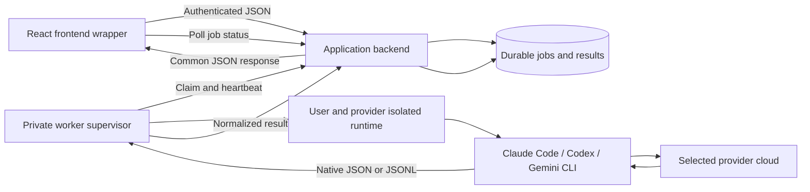

# CLI agent gateway implementation plan — revision 3

Browser onboarding follow-up, 12 October 2026: the approved [Antigravity onboarding implementation plan](ANTIGRAVITY_ONBOARDING_IMPLEMENTATION_PLAN.md) supersedes operator-assisted login as the intended user experience. It specifies first-use and Settings flows, saved credential reuse, host recovery and optional Maps Demo setup. It is a plan, not a claim that those features are deployed.

Planning/review date: 10 October 2026; status updated 11 October 2026. Frontend controls, authenticated backend protocol, database queue and Linux supervisor are implemented and the restored Supabase backend is deployed. The personal Antigravity vertical slice works: two real synthetic Hebrew frontend requests succeeded, including one after an actual Codespaces idle stop/restart. Native read denial, a text-agent canary, exact registry-fingerprint validation and 15 network checks support an explicit single-home personal approval. Full customer G1/G2 remain incomplete and false. Codex and Claude are disabled pending their own setup. Codespaces is an on-demand test host, with a reviewed one-command resume helper and offline frontend guidance.

The current deployment instructions and verified/unverified checks are in [the operational runbook](../deploy/cli-gateway/README.md). The user selected GitHub Codespaces for supervised testing because it requires no card within the personal free allowance. Codespaces session limits and Docker isolation/persistence must be validated before enabling execution. This planning document preserves the architecture; the runbook and implementation-status notes in the specification describe the actual code.

Read the [critical review](CLI_AGENT_GATEWAY_REVIEW.md) and then the [implementation specification](CLI_AGENT_GATEWAY_SPEC.md). This file explains the architecture; the specification defines the exact contract, private tables, state transitions, file map, defaults and ordered implementation tickets. Provider login, isolation and hosted-product eligibility are explicit gates, not assumed solved prerequisites.

Build a backend that accepts authenticated JSON jobs, runs the selected official CLI in the requesting user's private environment, and returns a common JSON result. Use Claude Code, OpenAI Codex CLI, and Google Antigravity CLI. Codex is the OpenAI CLI used here; it is not the ChatGPT website and does not automatically inherit website conversations, GPTs, or every ChatGPT feature. The CLIs still contact their providers' cloud services.

Implementation correction, 2026-10-10: the owner's legacy Gemini CLI native individual login was rejected by Google, with an instruction to migrate to Antigravity. The Google provider keeps its stable `gemini` API/database ID but now uses official `agy` 1.3.3. Previous Gemini free-account and policy assumptions are superseded by the [Antigravity account flow](https://antigravity.google/docs/cli/install/), [headless protocol](https://antigravity.google/docs/cli/headless/) and [permission controls](https://antigravity.google/docs/permissions/). Availability remains disabled until actual native login, entitlement and G1/G2 pass; an image build does not establish free access.

**Current application and integration point**

This plan targets the attached real-estate appraisal application. The gateway itself is reusable in another application, including the CRM mentioned in the discussion.

The active browser request helper is `web/src/lib/edge.ts`. It calls `supabase/functions/appraisal/index.ts`, which validates the user and workspace, reads personal prompts and provider settings, creates `generation_jobs`, invokes an API adapter, and persists results. `api/main.py` is a separate FastAPI scaffold, not the active generation route. The current synchronous generation path has a timeout/recovery limitation documented in `docs/WEB_POC_STATUS.md`.

Add `executionMode: "cli"` alongside the existing API mode. Keep the provider identifiers `anthropic`, `openai`, and `gemini`; map those to the three CLI adapters. CLI model availability needs its own provider/account capability list rather than reusing API model presets blindly.

**Provider feasibility and experimentation**

| Provider | Native automation | Account connection and experiment |
| --- | --- | --- |
| Claude Code | `claude -p --output-format json`; streaming and schema output are available | User signs into the published, unmodified CLI through Anthropic's flow. Use an existing eligible subscription for live testing; a generally available free CLI entitlement has not been established here. |
| OpenAI Codex | `codex exec --json -`; JSONL events and optional output schema | Native ChatGPT login, including `codex login --device-auth` where enabled. Free Codex access exists, but current pricing highlights desktop availability; validate the actual account's CLI entitlement before promising a free server experiment. |
| Google Antigravity CLI | Single framed stdin user message with `--input-format stream-json --output-format stream-json` | Interactive native personal Google login, then cached credentials. Validate native credential storage and actual account entitlement on Codespaces; legacy Gemini individual OAuth failed. No API-key fallback is configured. |

Sources: [Claude headless](https://code.claude.com/docs/en/headless), [Claude subscription guidance](https://support.claude.com/en/articles/15036540-use-the-claude-agent-sdk-with-your-claude-plan), [Codex non-interactive mode](https://learn.chatgpt.com/docs/non-interactive-mode), [Codex authentication](https://learn.chatgpt.com/docs/auth), [Codex pricing](https://learn.chatgpt.com/docs/pricing), [Gemini headless](https://geminicli.com/docs/cli/headless/), [Gemini authentication](https://geminicli.com/docs/get-started/authentication/), [Gemini quotas](https://geminicli.com/docs/resources/quota-and-pricing/).

There are two distinct milestones: proving native CLI execution with the developer's own account, and enabling hosted customer subscription access.

Claude's published hosting conditions allow end users to sign into an unmodified hosted CLI. They also require applicable commercial terms, preservation of built-in authentication choices, and no platform collection or intermediation of Claude account credentials/session tokens. Design the connection as access to the user's native CLI environment, not a custom Claude password form or token-import service. [Claude hosting and authentication conditions](https://code.claude.com/docs/en/legal-and-compliance).

OpenAI's documented third-party ChatGPT plan integration covers open-source and locally hosted apps and directs paid/remotely hosted apps to an interest process. Native device login demonstrates technical access; it does not itself establish approval for a hosted multi-user subscription product. Resolve the supported route before enabling that offering. [ChatGPT plan integration scope](https://developers.openai.com/siwc/token-sharing-open-source).

Use Google's genuine Antigravity CLI and native account login. Never extract tokens or reuse them in custom HTTP calls. Technical login does not establish eligibility for a hosted multi-user subscription product; keep customer release gated pending the required provider-specific evidence.

**System layout**



Use a Linux VM for the CLI execution server. As an initial sizing assumption, start with 2 vCPU and 4 GiB RAM and one active inference job globally; measure startup time, memory and latency before raising concurrency. This is a benchmark starting point, not a capacity guarantee. A local Linux VM can serve the development experiment without a paid cloud machine; hosting costs are separate from free model access.

Run a Python worker supervisor with asynchronous HTTP/output handling and Docker Engine lifecycle management, matching the existing Python project. Install pinned official CLI releases in versioned runtime images. The supervisor runs continuously and pulls jobs through a narrowly scoped backend worker interface over TLS. The browser never accesses the supervisor or container manager directly. Use systemd to restart the worker.

Give each user/provider connection a private persistent CLI home volume and launch an ephemeral isolated container for each job. No idle container per customer is needed. The reference prototype uses rootless Docker on Linux; engine resource and network isolation must be tested. Use stronger VM isolation for general untrusted customer access if the threat assessment requires it. Never share one logged-in home across users. A separate directory alone is not a security boundary.

Keep native CLI authentication storage in that user's environment, on encrypted persistent storage with restrictive permissions. The application database stores connection metadata and an opaque runtime reference only. No general-purpose OAuth-token extraction or token copying into the provider-key table. Hosting still makes the server operator a trusted party; isolation does not remove that responsibility.

**Account connection workflow**

1. In prototype Settings, the user requests provider setup and sees an honest pending state. Do not present an unimplemented automatic account connection as working.
2. The backend creates a user-bound connection record and assigns a private runtime. The operator and account owner complete the native login experiment described in specification section 8.
3. For the initial experiment, use operator-assisted native terminal access. Customer-facing remote terminals and automatic OAuth callbacks are a later, separately reviewed deliverable. Any temporary terminal is restricted to that user's environment and excluded from logs/recordings; it must not expose the host shell.
4. The user completes provider-hosted authentication. Codex device login is one documented option; Claude and Antigravity use their native flows. Do not assume all three support the same device-code or callback mechanism. Prove remote login and callback handling in the initial authentication spike.
5. The CLI owns credential persistence and refresh. The backend records only `connected`, `reauth_required`, or `disconnected`, a masked account label where supported, and the runtime reference. A successful login is followed by a tiny explicitly initiated live run to confirm actual entitlement.
6. Disconnect blocks new jobs, cancels/settles active work, invokes native logout where supported, and deletes the private local auth state. Offer provider-side revocation instructions where logout does not revoke server-issued tokens.

A native authentication spike that cannot complete securely on the target server is a blocker for that provider's hosted adapter. Keep that provider disabled with an explanation; do not replace the native flow with credential scraping. A user-owned local worker is a possible later deployment option, not an assumed equivalent to the requested server setup.

**Frontend wrapper and JSON contract**

Add `web/src/lib/cli-agent.ts` over the existing authenticated Edge helper. Implement the exact actions in specification section 3, including lookup by request ID after an ambiguous submission. Retain the request ID across network retries and page reloads. Poll with backoff initially; streaming can follow after the basic lifecycle works.

Example appraisal submission, using the existing action-based endpoint:

```json
{
  "action": "createCliJob",
  "schemaVersion": 1,
  "requestId": "849698ca-b7d6-4dbd-b48b-406ef8405a6b",
  "connectionId": "d0d32e5e-a5fb-4b4a-a6ed-9bbf60414917",
  "workspaceId": "6928d220-7ad8-4b71-9d34-842939418f65",
  "sectionId": "environment_description",
  "address": "Synthetic test address",
  "example": "A short style example",
  "additionalRequest": "Write in Hebrew.",
  "modelSelection": "provider-default",
  "consent": true
}
```

The backend derives the provider from the owned connection and assembles an immutable prompt snapshot from the form and saved instructions. V1 supports text-only environment descriptions; attachments, search, plot reports, arbitrary models and generic chat are explicitly rejected in CLI mode. Never accept executable paths, environment variables, arbitrary CLI flags, or filesystem paths from the browser. User identity comes from the verified application session, not request JSON. Provider credentials are never included in generation requests.

Return HTTP 202 promptly:

```json
{"job":{"id":"bf3b5a12-5a7d-48bf-8ef8-e6c40467b4c9","status":"queued","executionMode":"cli"}}
```

The frontend uses the same endpoint with `{"action":"getCliJob","jobId":"bf3b5a12-5a7d-48bf-8ef8-e6c40467b4c9"}` until a terminal state:

```json
{
  "job": {
    "id": "bf3b5a12-5a7d-48bf-8ef8-e6c40467b4c9",
    "status": "succeeded",
    "provider": "gemini",
    "executionMode": "cli",
    "modelRequested": "provider-default",
    "modelResolved": null,
    "output": {"text": "Generated answer...", "data": null},
    "usage": {"inputTokens": null, "outputTokens": null},
    "error": null
  }
}
```

V1 returns text inside a JSON envelope; `output.data` is null. A later structured-data feature must validate it against a backend-selected schema. A CLI's JSON envelope does not guarantee its answer text is valid application JSON. Missing usage stays null; do not infer exact billing or subscription capacity from token counts or CLI cost estimates.

Display queued/running/reconnecting states, the final editable answer, and a cancel button. Render generated Markdown safely. For failures, return stable codes such as `AUTH_REQUIRED`, `PLAN_REQUIRED`, `QUOTA_EXCEEDED`, `TIMEOUT`, `INVALID_OUTPUT`, and `CLI_FAILED`, with sanitized user messages. Never return raw stderr, credential paths, login secrets, hidden reasoning, or unfiltered tool events.

**Backend wrapper and adapters**

Use one adapter interface with provider-specific implementations:

```text
inspect_connection(runtime) -> connection status and supported capabilities
build_invocation(job, runtime) -> fixed executable, argument array, stdin
parse_output(stdout/events, exit_status) -> normalized result or typed error
cancel(container_ref) -> confirmed stopped container
```

For Claude, parse the terminal result/error envelope. For Codex, incrementally parse JSONL and select the final assistant result and run outcome rather than treating stdout as one JSON document. For the Google slot, parse Antigravity NDJSON and require one init and one final result with SUCCESS and one turn, plus a zero native exit. Reject legacy Gemini envelopes. Pin parser fixtures to each supported CLI version. Always check both protocol success and process exit status, including empty, partial and oversized outputs.

Spawn a fixed executable with an argument array, no shell; send prompt content through stdin using the tested native interface. Read stdout and stderr concurrently into bounded buffers. Never put prompts or secrets into a shell command string. Give the subprocess an explicit environment allowlist with only its native credential context. Application database/service credentials and the worker dispatch credential must never be inherited by the CLI.

Start with text-only runs and disabled optional tools, hooks, plugins and MCP connections. Tool configuration differs by CLI and must be verified against the pinned version. Do not use universal approval-bypass switches. Claude's `--bare` does not use subscription login, so it is unsuitable for the subscription prototype; use a clean controlled runtime and explicit supported tool settings instead. [Claude programmatic mode](https://code.claude.com/docs/en/headless), [Claude CLI reference](https://code.claude.com/docs/en/cli-reference).

Containers run without host mounts, host process visibility, cloud metadata access, or a Docker socket. Mount only the relevant user's CLI state and that job's inputs. Restrict network destinations to the verified provider/login requirements. The supervisor alone controls runtime creation. Do not assume a CLI filesystem sandbox alone hides readable authentication files from agent tools.

**Durable job lifecycle**

Use the existing database for the initial durable queue; no Redis dependency is needed for this prototype. Implementation must add an atomic claim operation, lease, heartbeat and attempt token, rather than selecting queued rows and updating them in separate requests. Restrict worker operations to their assigned runtime/jobs. Browser-visible tables require appropriate RLS; connection/auth metadata is private to its owner even when report history is team-visible.

Keep CLI connection, host, lease/attempt and immutable prompt data in private tables. Public generation jobs are team-readable: never store CLI authority in their existing public lease fields. Add `execution_mode` and a conditional credential constraint so API jobs retain a positive credential version while CLI jobs use null. The private connection revision is separate. The specification lists exact fields and grants.

Reuse existing statuses: `queued`, `running`, `cancel_requested`, `succeeded`, `failed`, `cancelled`, `expired`, and `needs_review`; no automatic `retry_wait` inference in V1. Deduplicate by authenticated user and request ID with a client-payload hash; freeze instructions separately. A lost HTTP response must not cause a second inference.

Begin with one running inference globally and one active job per connection. Apply a five-minute execution deadline and fifteen-minute queue expiry. Stop/kill the actual job container and confirm its state; killing a host-side Docker client does not terminate the container. The specification defines the cancellation/completion race. Cancellation does not guarantee the provider consumed no quota.

On worker failure, first reconcile the old runtime/process. A lease expiring is not permission to start another inference while the old one may still be running. Use fencing tokens to reject stale results. Retry result persistence idempotently without rerunning the model. When completion is uncertain, mark `needs_review` and let the user explicitly start a new attempt; do not promise exactly-once provider execution.

Persist the validated result, report revision and idempotent completion receipt atomically before advertising success. Use a new CLI finalizer rather than `poc_finish_job`, preserving section-before-job locking and the existing ten-completed-report retention policy. Never silently switch provider/account or fall back to billable API credentials. Owners control CLI jobs/connections; teammates retain existing saved-report access. The specification defines permissions separately for each operation.

**Files and conversation scope**

The first working slice accepts text-only environment descriptions. A later slice uploads files to private temporary storage, references authorized object IDs in the job, and stages only those files. For text extraction, reuse suitable existing extraction code after compatibility checks; PDF/image support needs provider-specific validation. Revalidate file size/type, use server-generated names, and prevent path traversal. Preserve the application's existing limits until explicitly changed.

Native CLI transcripts, private prompt snapshots and temporary job folders add retention surfaces even without attachments. Delete after acknowledged completion and sweep remaining terminal payloads within 24 hours. Implement native history cleanup without deleting refresh credentials; if that cannot be done reliably, delete the home and require reconnect. Exclude auth volumes from backups. Keep the existing ten-result team history and never restore pruned content on a completion retry. Specify uploaded-file retention separately before enabling uploads.

Use fresh CLI conversations per report in the first release. If follow-ups are added, map application conversations to provider sessions by user, workspace, provider and connection. Never use a global 'resume latest' command. Persist CLI state only in the corresponding private runtime.

**Implementation sequence and acceptance**

1. Authentication and entitlement spike: run a harmless prompt in official Antigravity CLI with any free entitlement actually available to the developer's Google account on the target Linux environment. Verify restart/refresh/logout. Repeat with Codex and Claude only with available eligible accounts. Record versions and separate technical success from hosted-product eligibility.
2. Backend slice: durable submission/claim/completion, isolated subprocess runner, common result/error contract, deadlines and cancellation. A deterministic test adapter covers protocol failures without using paid quotas; it is never presented as a real model answer.
3. Frontend slice: provider connection status, CLI mode selection, submit/poll/cancel, editable final answer and existing history integration. Prove browser -> backend -> real CLI -> persisted answer -> browser with Gemini.
4. Provider parity: add Codex and Claude parsers and native connection flows behind per-provider availability flags. Verify actual subscription authentication and ensure no API key silently takes precedence.
5. Customer readiness: validate permitted hosted-account integration for each enabled provider; finish isolation/ownership checks, reauthentication, cleanup, recovery, and then add attachments and optional streaming.

Acceptance checks: two users cannot control each other's connections/jobs or read private worker state, while existing team report sharing still works; a duplicate submit makes one invocation; an expired login produces reauthentication UI; quota exhaustion causes no fallback charge; malformed output fails cleanly; cancellation stops the container; worker restart cannot duplicate a possibly active inference; result persistence failure does not rerun the CLI; saved Hebrew text survives the complete browser round trip. The specification contains the full failure/race matrix and T0–T10 implementation sequence.

The first milestone is a real Google Antigravity round trip on the server using any free entitlement the owner's account actually provides. All three adapters belong in the design, but production availability must reflect demonstrated login, entitlement, hosted-use support and isolation for each provider.
