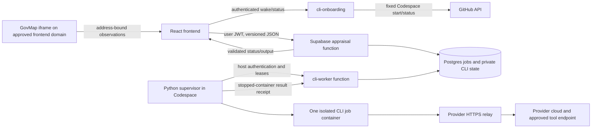

# CLI gateway integration: agent handoff and operating guide

Last consolidated: **15 October 2026**, after commit `fe3a5da`.

**27 October update:** Environment CLI submissions with GovMap evidence exposed an old plot-only database constraint. The narrowly scoped migration is now deployed; see [the incident and verification record](CLI_ENVIRONMENT_EVIDENCE_FIX.md). The original request was rejected before native execution. This supersedes the earlier assumption that the environment evidence path required no schema change.

**27 October frontend follow-up:** Environment CLI submission no longer waits for GovMap. Ready, fresh matching evidence is optional; failed or pending lookups cannot block the CLI. Live testing reproduced false empty suggestions for Bar Yochai 8, Ramat Gan. Correction `e42a30a` removes the unverified `layers: ['address']` search filter and fixes the misleading empty-results message. `ab8d580` also reveals explicitly requested CLI maps to allow render-dependent initialization. The user authorized deployment; **production autocomplete → keyboard selection → map → ready evidence now passes without retry**, with block 6145 / parcel 1203, in deployment `dpl_EkAALBa9ySdvTDMW2aqQoiWvkYbF`. See [behavior and regression verification](CLI_GOVMAP_OPTIONAL_LOOKUP.md).

Purpose: give another engineering agent enough context to maintain, reproduce, and extend the personal Antigravity/Claude integration without repeating its implementation and diagnostic mistakes. This is a guide to the existing application, not a claim that every planned feature is deployed or that the experiment is approved for general customer hosting.

This document records the last verified checkpoint. It does **not** make a fresh assertion about an asleep Codespace, account allowance, deployed frontend revision, or current provider terms. Recheck those before acting. No credentials, authorization codes, or complete private configuration files belong in this document.

## 1. Read this first

1. Use the existing architecture and saved section agents. The owner wanted CLI tools and data access, not replacement report instructions or a different agent framework.
2. Keep each user's provider login in its own native Docker home. Sharing a machine/image is supported; copying another user's authentication is not the mechanism.
3. Google Maps is a shared backend capability for approved Claude users. The owner explicitly authorized the shared Demo key. Do not ask every user to retrieve a Maps key. The key is already provisioned privately; do not print or retrieve its value for a handoff.
4. **Claude Maps works; Antigravity Maps does not yet.** Antigravity web search works, but full-report reliability has unresolved failures. Never describe both providers as having identical tool access.
5. GovMap is collected by the application's domain-authorized browser SDK and supplied to the agent as evidence. It is not an autonomous GovMap MCP server.
6. Ordinary users must not operate a terminal. Existing-account wake-on-send works. Fresh browser-only sign-in remains unfinished; a Settings connection request alone does not authenticate a native CLI.
7. Commit before deploying any service. The owner controls frontend deployment to Vercel. Do not infer permission to push Git or deploy the frontend from permission to update the worker/backend.
8. Never replay an uncertain native attempt. Retry delivery/status with the same identity; a new inference requires an explicit new submission.

## 2. Status: what actually works

| Capability | Antigravity | Claude Code |
| --- | --- | --- |
| Internal CLI provider ID | `gemini` | `claude` |
| Native command/version | `agy`, 1.3.3 | `claude`, 2.1.296 |
| Native personal-account login | Verified for the two explicitly owned Google identities | Verified for uzan86's Claude Pro account |
| Separate native homes | Verified; second account does not replace first | Existing home isolated from Google homes; additional Claude homes still need verification |
| Automatic Codespace wake | Verified for saved Google accounts, including deployed-site cold start | Provider-aware implementation deployed; recheck a full cold-start cycle when changing this path |
| Active research profile | `web-search-v1` | `claude-web-search-maps-demo-v1` |
| Web search | Native `search_web`, verified with real results | Native `WebSearch`, verified with real results |
| Google Maps | **Not activated/verified** | Official HTTP MCP; live native and deployed-app lookup verified |
| GovMap | Evidence can be supplied by the app's source collection paths | Live collection-to-Claude acceptance verified 27 October; optional lookup, corrected autocomplete and visible map readiness are deployed and verified |
| Fresh browser-only onboarding | Implemented components/protocol infrastructure, not enabled or accepted end to end | Supervised native login verified; no completed Claude browser-only wizard |
| Full environment reports | Earlier successes exist; later long runs failed under second account and are not fully diagnosed | Successful deployed reports and Maps lookup; account quota can independently block requests |
| Session/quota display | Structured Google quota observed; dedicated mapping still outstanding | Observed native session-limit response now maps to `QUOTA_EXCEEDED` |

OpenAI Codex remains a visible but unconnected option. Its initial nonexistent `CODEX_HOME` bug was corrected, but personal sign-in and full integration were not completed. Do not enable it merely because an image builds.

### Live evidence worth knowing

- Antigravity automatic cold-start job `a654ae39-35e2-4d8d-9071-11ad47a6f254` succeeded with the editor closed. An accepted queued job survived the stale-heartbeat window without resubmission.
- The second Google owner's deployed job `5dec0e45-bdb6-4f49-b565-99a085e5cbcc` proved automatic start and worker launch, but its native response was empty. Wake success did not prove inference success.
- Claude Maps job `bb897703-f60e-4afa-be73-944d378a7309` succeeded through the existing deployed frontend as uzan86, locating Hillel Yaffe Medical Center in Hadera and returning the tool's Google Maps place link.
- Job `5b6ac36f-2ba7-43f1-aa66-8fa34e0ae2ec` described Uziel 48, Ramat Gan **and** the hospital because the test's hospital instruction remained in `additional_request`. This was proven in the submitted database record, not guessed from the answer.
- Job `9b83e187-24ca-43f0-94c8-8c8151ef40b6` contained the corrected Maps request for Uziel 48 and failed after about 16 seconds. Original native details were discarded. Later fixed synthetic probes on the same runtime/account established current Claude session exhaustion; that is the likely original cause, not a recovered original message.
- The synthetic native error was `You've hit your session limit · resets 4:50pm (UTC)` on October 15, equivalent to 19:50 Israel time that day. This is historical evidence, **not a current reset promise**.

## 3. System and trust boundaries



Installing a CLI does not host the model. Native CLI inference still contacts its provider and consumes that user's plan allowance.

- **Frontend:** user input, provider/model selection, GovMap collection, immutable request identity, wake progress and result polling. No worker/GitHub/provider credential is exposed here.
- **Appraisal Edge function:** authenticates the app user, checks membership/connection, builds the task from saved instructions and source evidence, freezes it, and handles application-level validation.
- **Postgres control plane:** ownership, revisions, job state, deadlines, leases, exclusive host slot, idempotency and receipts. Do not replace these with a detached `subprocess` HTTP wrapper.
- **Worker:** claims authorized work, checks approved manifests/account bindings, starts one constrained CLI, parses native output, confirms process stop, and settles the receipt.
- **CLI container:** only its own native home, approved immutable policy/config, ephemeral workspace, and restricted network. No Docker socket, app repository, host secret, Supabase service key, or GitHub wake token.
- **External data:** tool/page text is untrusted evidence. It must not widen tool permissions or become executable host configuration.

### Three different provider names

Do not assume display names, CLI IDs and saved report IDs are interchangeable:

| Layer | Google | Anthropic | OpenAI |
| --- | --- | --- | --- |
| UI label | Google Antigravity | Claude Code | OpenAI Codex |
| CLI gateway/connection ID | `gemini` | `claude` | `openai` |
| Historical report provider field | Inspect the job | Can be `anthropic` | Inspect the job |

For example, the failed Claude job above has `provider_id='anthropic'` in `generation_jobs`, while its connection/worker provider is `claude`. Use the connection and `execution_mode` when tracing it.

## 4. Code map

All paths below are relative to the repository root.

| Concern | Starting files |
| --- | --- |
| Frontend execution page and defaults | `web/src/App.tsx`, `web/src/lib/execution-defaults.ts` |
| Common CLI form/account UI | `web/src/components/CliRequest.tsx`, `CliAccountControls.tsx`, `CliSubmissionStatus.tsx`, `CliJobStatus.tsx` |
| Frontend state/readiness/wake | `web/src/lib/use-cli-account.ts`, `use-cli-submission.ts`, `cli-status.ts`, `cli-host-ready.ts`, `cli-agent.ts` |
| Browser onboarding UI/protocol | `web/src/lib/cli-onboarding.ts`, onboarding components; `supabase/functions/cli-onboarding/` |
| Frozen CLI task and validation | `supabase/functions/appraisal/cli-actions.ts`, `cli-contracts.ts`, `cli-evidence.ts`, `cli-models.ts`, `generation-input.ts` |
| Worker and scheduled maintenance endpoints | `supabase/functions/cli-worker/index.ts`, `supabase/functions/cli-maintenance/index.ts` |
| Supervisor, manifests, recovery | `src/cli_gateway/main.py`, `runner.py`, `recovery.py`, `personal_accounts.py`, `startup.py` |
| Invocation and native parsing | `src/cli_gateway/adapters/base.py`, `contracts.py` |
| Antigravity tools/policy | `src/cli_gateway/research.py`, `deploy/cli-gateway/RESEARCH.md` |
| Claude tools/model presets | `src/cli_gateway/claude.py`, `docs/CLAUDE_MODELS.md` |
| Relay and isolation | `src/cli_gateway/network.py`, `egress.py`; `deploy/cli-gateway/*-egress.json`, `provision-egress.py`, `repair-codespaces-network.py`, `verify-egress.py` |
| Native setup/verification | `deploy/cli-gateway/native-login.py`, `verify-native.py`, `verify-claude.py`, `probe-research.py`, approval helpers |
| Native login implementation | `src/cli_gateway/login.py`, `login_protocol.py`, `login_terminal.py`, `login_crypto.py`, `login_recovery.py` |
| Maps credential/catalog staging | `src/cli_gateway/maps_config.py`, `deploy/cli-gateway/configure-maps.py` |
| GovMap embed and parsing | `web/govmap.html`, `web/src/govmap-frame.ts`, `web/src/components/GovMapPanel.tsx`, `web/src/lib/govmap.ts`, `govmap-responses.ts` |
| Environment GovMap projection | `web/src/lib/cli-govmap-evidence.ts`, `supabase/functions/appraisal/cli-evidence.ts` |
| Optional GovMap address suggestions | `web/src/components/GovMapAddressInput.tsx`, `web/govmap-address.html`, `web/src/govmap-address-frame.ts`, `web/src/lib/govmap-address.ts` |
| Comparables | `NearbyTransactions.tsx`, `AutomaticComparables.tsx`, `ImportedTransactions.tsx`; corresponding appraisal collection/validation modules |
| Diagnostics | `deploy/cli-gateway/diagnose-claude.py`, `diagnose-search.py`; fixed counters in `runner.py` and adapter |
| Build/provenance | `deploy/cli-gateway/releases.json`, `build-images.py`, `Dockerfile.provider`, `Dockerfile.antigravity`, `watchdog.py` |
| Startup | `deploy/cli-gateway/resume-personal.py`, `codespace-post-start.sh`, `install-codespace-startup.py`, `backup-runtime.py` |

Inspect current imports rather than assuming an old plan's proposed filenames exist. For example, CLI task assembly is in `cli-actions.ts`, not `cli.ts` or `cli-task.ts`.

## 5. Environment inventory and identifiers

These are identifiers/paths, not secrets. Verify them against current state; do not create duplicate services.

| Resource | Checkpoint value |
| --- | --- |
| Local repository | `C:\Users\elior\Desktop\Real-Estate_appraisal` |
| Git repository | `EliorUzan/real-estate-appraisal`, local branch `master` |
| Deployed frontend | `https://real-estate-appraisal-sage.vercel.app/` |
| Local frontend | `http://127.0.0.1:5175/` |
| Supabase project | `cdgjvtzxfpguqetpljae` |
| Codespace | `refactored-winner-7w5x75jrvjv2wqwv` |
| Codespace editor | `https://refactored-winner-7w5x75jrvjv2wqwv.github.dev/` |
| Remote source checkout | `/workspaces/real-estate-appraisal` |
| Private state root | `/workspaces/.cli-gateway-state` |
| Worker environment file | `/workspaces/.cli-gateway-state/worker.env`, private regular file |
| Registered host | `647bab19-727c-4040-b48a-7ee5831a1d7a` |
| Test workspace | `8d568b7b-fe3b-458b-8079-ed213f73ac4d` |
| uzan86 app user | `e65eb37b-fad1-4d80-b615-26a8c41a46ed` |
| elioru app user | `5ef707c6-9384-4f2d-9875-6117df1c4e88` |
| uzan86 Claude connection | `f3d7cccc-c241-46eb-95c0-c5d6e080799b`, revision 1 at checkpoint |
| uzan86 Claude home | `cli-home-b8bc7cd2-46d2-4b4f-8633-9fe3e2eb71d2` |
| uzan86 Google connection | `ba85cd76-7b81-40af-aef4-c1f64f2a6b66` |
| elioru Google connection | `ef54b6bf-9100-429b-8058-b8ed1bc9541a` |

Read `CLI_DATA_DIR` and `CLI_MANIFEST_DIR` from the private environment **inside the host process**, without displaying the file. Runtime state for this installation lives under the private state root, including `runtime/`, `builds/`, manifests and image-only backups. Do not substitute the VM paths from `worker.env.example` blindly.

Last verified immutable runtime fingerprints:

| Runtime | Image SHA-256 | Active base manifest SHA-256 |
| --- | --- | --- |
| Antigravity | `c86c5ff70ea63c1c728a9ff407f60a3fe659111be577a59294c57a61ab6de5af` | `47296394b2195a2265b1bf56219e6dcf8d8868c512338e004ca9a3db59be77be` |
| Claude with Maps | `80f0d887b74b0470397ea85a5ede626ff0be429ad4f0da2a13cb33f462d7f70f` | `e9197dce5ab1fb185f2ba7bd40bdb83461266f57ea16c3dca8b6f2774671d9dd` |

Docker local image references use `sha256:<digest>`. These are not universal image-download URLs. Backup receipts and `releases.json` establish rebuild provenance. An identical version string does not mean an identical image or approved policy.

### Why this host was selected

The existing Render service was a free web service without the persistent-storage/SSH setup needed for the planned native-login worker. It was not treated as a suitable execution host. A Linux VM was considered; the owner wanted a sufficient free tier and no credit-card registration. Oracle's card requirement ruled it out, and a paid DigitalOcean VM was not approved. The owner then approved GitHub Codespaces specifically for testing, accepting a supervised, finite-allowance host that sleeps.

Do not restart that provider-selection loop or purchase a VM to solve a normal idle stop. Do not assume the Codespace is an always-on free production server. Check GitHub's current allowance and retention policy when planning capacity; earlier estimates of free hours are not a durable guarantee. The Supabase project was originally inactive and was reactivated during setup; verify current service health before treating an outage as a CLI bug.

## 6. Request lifecycle and saved agents

1. The user chooses report section, API/CLI mode, CLI account and a supported model preset.
2. `CliRequest` gathers address, optional style example, additional request, consent (selected by default), team and optional source evidence.
3. The frontend freezes the submission and UUID. `sessionStorage` retains a small pending identity, separately for each report section; it does not contain native credentials.
4. Readiness resolves **the selected connection's provider**. If a saved connected account's host is asleep and wake is configured, wait for automatic wake rather than requiring a terminal.
5. The appraisal function reads `agent_prompts` for that user and section. Environment and plot use `generationInput`: saved personal instructions replace the default, then address/style/additional request/evidence form the input.
6. The backend hashes the client intent and frozen payload, checks the prompt version, and creates/returns the idempotent job. It permits one prompt-version refresh; it does not silently replace the task after admission.
7. The worker claims it with the exact manifest, connection revision, home and lease. It journals identity/start intent before starting the native process.
8. Native output is accepted only after protocol validation and confirmed container stop. Receipt delivery can retry; inference cannot.
9. The frontend polls and displays the saved result. Comparable-sales output gets additional application-level validation before presentation.

Important exception: the newer automatic `over` comparables route uses its fixed task contract (`OVER_PROMPT`). Do not promise every route blindly uses the editable general section prompt. Other comparable routes combine the saved/default agent with a strict JSON contract and validated candidate facts. Read `cli-actions.ts` when answering which instructions a particular flow used.

CLI mode must not accidentally invoke `callProvider` with an app API key. The transaction pipeline captures/freezes the existing validated analysis task, then routes analysis to the CLI. Preserve source amounts/areas and candidate IDs; do not let generated JSON overwrite source facts.

### Avoid contaminating the next request

The form's optional textareas are collapsible. A collapsed field can still contain text and is still submitted. At this checkpoint `useCliSubmission.reset()` clears the request identity/result but **does not clear `CliRequest`'s address/example/additional state**. This UX trap has not been fixed in the source.

After any synthetic test, explicitly clear the additional-request/style fields and verify their actual input values. For a reported unrelated subject, inspect the saved `address`, `additional_request`, saved agent and frozen task before blaming provider memory. A clean future request is the verification; editing historical output or silently stripping arbitrary instructions on the server is not a valid fix.

Recommended follow-up: make “יצירת בקשה חדשה” explicitly reset per-request content, show when collapsed fields are populated, and add a clear action. Preserve drafts on navigation/cancel-wake as already designed; do not clear a user's draft on every address keystroke.

## 7. Authentication and multiple users

### Existing verified accounts

An ordinary Codespace stop/start should reuse the saved native home without sign-in. Distinguish these states:

- Saved account + sleeping host: wake the host.
- `pending_setup`: setup was requested but native authentication/verification is not finished.
- `reauth_required`: new official provider login is needed.
- Draining/quarantined host: operator recovery, not a user login problem.
- Provider quota reached: wait for provider allowance; reconnecting is not a quota reset.

The integrated browser's logged-in Google/Claude account is not itself the native CLI credential. Native authorization must complete for the intended app connection/home, and the observed account must be verified.

### Supervised setup used in this experiment

On the drained idle host with the supervisor stopped, the operator used:

```sh
cd /workspaces/real-estate-appraisal
PYTHONPATH=src python3 deploy/cli-gateway/native-login.py \
  --config /workspaces/.cli-gateway-state/worker.env \
  --connection <PENDING_CONNECTION_UUID> --revision <CURRENT_REVISION> \
  --build <PRIVATE_PROVIDER_BUILD_JSON>
```

The helper checks the pending connection from host-scoped maintenance, mounts its own home, and starts `agy` or `claude auth login`. It stops after a bounded login window. Native success intentionally leaves the connection pending until verification; do not flip it green just because a page showed success.

Claude's long authorization URL was overwritten/wrapped in narrow raw terminals. The helper now displays bounded complete native URL blocks with CRLF. Reconstruct wrapped URL text exactly; don't reuse expired state. The native callback can require the full `code#state` value. Passwords and codes stay in the official page/native flow or the eventual dedicated frontend field, never committed or included in general logs.

For Claude, fresh offline `claude auth status` confirmed `loggedIn: true`, `authMethod: claude.ai`, and the expected account before live verification. Do not dump credential files to identify the account.

### Browser-only login: still unfinished

The approved target is: first-use/Settings → start a bounded session → open allowlisted official auth URL → user completes provider page → user pastes code in the app → encrypted delivery to the waiting native CLI → credential persistence and verification → explicit report submission.

Implemented building blocks include the Hebrew wizard, private login state, RSA-OAEP/AES-GCM sealed delivery, leases, cancellation/recovery, bounded terminal screen parsing, current-screen code-entry fence, and at-most-once code input. The pinned Google protocol is `antigravity-login-v1`; it is not a generic Claude protocol.

Missing live protocol/permission/expiry/persistence evidence is an engineering task. Do not make users solve it in terminals, and do not bypass evidence flags to make a wizard appear operational. Read the onboarding plan/status/runbook before enabling `CLI_LOGIN_MANIFEST_DIR` or broadening allowed owners.

### Adding an account on the same image

1. Create/identify that app user's own connection, revision and native volume.
2. Authenticate natively into that volume; verify the expected provider identity.
3. Run fresh account-specific inference and permission-denial checks, plus current network checks.
4. Bind evidence to owner, connection, revision, home and base manifest.
5. Additional Google bindings live in `<CLI_MANIFEST_DIR>/accounts/`; `approve-personal-account.py` is the Google research helper. Generic loading is in `personal_accounts.py`.
6. The binding must preserve the base image/tool/network/settings/release scope exactly. Unknown homes remain rejected.
7. Update only the intended connection and preserve other owners. Add the owner to the fixed host's wake allowlist where appropriate; account binding alone does not grant wake.
8. Verify from that user's frontend, not just from the first user's session.

Do not assume the Google approval helper creates a Claude account binding. Additional Claude homes need their own correctly scoped verification path. The current Maps upgrade helper rejects extra Claude bindings during base-profile rotation; it cannot safely upgrade an arbitrary multi-account installation as written.

## 8. Antigravity: what enabled search, and what failed

Legacy Gemini CLI built successfully but Google's individual sign-in rejected it and directed migration to Antigravity. The runtime was switched to official pinned Antigravity 1.3.3; the historical `gemini` ID was deliberately retained to avoid breaking stored connections/jobs.

The original text-only profile had no useful external research. To enable search we changed the **capability profile**, not the user's report instructions:

- `research.py`: reviewed agent `cli-gateway-research`, `tools: [search_web]`, `excludeDefaultComponents: true`, no plugins/skills/MCP/delegation, command execution off.
- Strict native policy denies file access, command execution, direct URL execution, unsandboxed operations and MCP.
- Exact agent/policy/registry bytes and native evidence are bound to the approval.
- Invocation uses stream JSON over stdin, stream JSON output, the selected reviewed agent and official updater opt-out.
- Parse native init/agent/permission/registry events, every tool update, and one terminal result. A registry with 60 entries did **not** prove that all 60 tools could execute. Actual denied-read and canary checks were required.
- Page-reading probes emitted events but returned empty final answers. Page reading was not approved; `search_web` is the active capability.

The five allowed inference relay destinations are in `antigravity-egress.json`: `daily-cloudcode-pa.googleapis.com`, `cloudcode-pa.googleapis.com`, `oauth2.googleapis.com`, `www.googleapis.com`, `lh3.googleusercontent.com`. Startup identity/profile dependencies were established by fixed probes; metrics traffic remained blocked.

Native writable global config/conversation directories were needed even with an otherwise read-only container. Put those in bounded ephemeral mounts while preserving immutable operator settings. Do not solve this by mounting the entire repository or allowing arbitrary writes.

### Parser and deadline lessons

- One native tool step produces repeated updates. Count distinct validated `step_index` values, not every update, for the 64-step cap. Keep validating every update.
- Approved Google research has a 600-second worker/database window and 570-second native print timeout. Other runs retain 300 seconds. The image watchdog must agree with the worker and DB; changing one layer alone is insufficient.
- `SUCCESS` plus empty response is not usable output. Native `ERROR` with an attractive partial answer is not success. Never publish the partial answer to hide failure.
- Later full reports failed around 492–547 native seconds with roughly 50–56 distinct searches, below the byte/step/deadline caps. Increasing the deadline again is not justified by that evidence.
- Short one-search success does not establish long-report reliability.
- A later synthetic public report explicitly returned `Individual quota reached`, `AGY_ERROR`, `RESOURCE_EXHAUSTED`, HTTP 429. Its reported reset was about 165 hours, not “tomorrow.” That does not retrospectively explain earlier attempts whose native errors were not retained.
- Dedicated mapping of that Google structured quota signal is still outstanding. Do not implement broad substring matching against arbitrary report text or free-form stderr.

## 9. Claude: native search and Google Maps

The base `claude-web-search-v1` profile exposed WebSearch only, blocked `mcp__*`, and passed an empty MCP config. Claude correctly said it had no Maps tool. A frontend “Maps configured” label or a key existing elsewhere cannot change that.

### Active Maps profile

`src/cli_gateway/claude.py` defines `claude-web-search-maps-demo-v1`:

- Allowed tools: `WebSearch`, `mcp__google_maps__search_places`, `mcp__google_maps__resolve_names`.
- Denied: Bash, Read, Write, Edit, WebFetch, Agent; Maps routing, weather and URL-resolution tools remain denied.
- Strict MCP config, fixed setting sources, disabled hooks/account connectors, no Chrome/slash commands/session persistence, `dontAsk` permissions, maximum 12 turns.
- HTTP MCP URL: `https://mapstools.googleapis.com/mcp`.
- Runtime mount: `/opt/gateway/claude-maps.json`, read-only.
- The relay permits the exact Maps hostname alongside `api.anthropic.com`, `claude.ai`, `platform.claude.com`.

Non-secret configuration shape (placeholder only):

```json
{
  "mcpServers": {
    "google_maps": {
      "type": "http",
      "url": "https://mapstools.googleapis.com/mcp",
      "headers": {"X-Goog-Api-Key": "<PRIVATE_SHARED_DEMO_KEY>"}
    }
  }
}
```

The key is in a private regular file, mode 0600, outside Git. Its exact config bytes/hash are bound to the manifest and evidence; the runner validates shape, endpoint and permissions before mounting. It is not supplied through a prompt, CLI argument, browser environment variable or ordinary database column.

### Reproducing the verified activation

This procedure describes an upgrade **from the base WebSearch profile**. Do not rerun `--upgrade-maps` on the already upgraded live manifest.

1. Preserve the existing native home and base approval. Drain the idle host and stop the supervisor under the common lock.
2. Build/verify pinned Claude from official provenance if not already available. A version/help check is credential-free and does not consume inference allowance.
3. Complete native account verification and the base WebSearch approval (`verify-claude.py`); inspect its current `--help` and prerequisites first.
4. Provision the shared key once with `configure-maps.py --config <private-env>` using its hidden interactive input. It creates `maps-mcp.pending.json` under `CLI_DATA_DIR` and intentionally refuses to overwrite an existing candidate.
5. `verify_key` performs MCP initialize/initialized/tools-list. It handles JSON or a bounded SSE response. Catalog success proves credential/protocol access, not native tool execution.
6. Stage the exact reviewed Claude egress policy, back up the old file before replacing it, provision the credential-free relay, apply only the approved same-bridge rule, and run all 15 network checks.
7. Run the versioned upgrade helper with the actual private build/egress paths and exact existing connection/revision:

```sh
PYTHONPATH=src python3 deploy/cli-gateway/verify-claude.py \
  --config /workspaces/.cli-gateway-state/worker.env \
  --build <PRIVATE_CLAUDE_BUILD_JSON> --egress <PRIVATE_CLAUDE_EGRESS_JSON> \
  --connection <VERIFIED_CLAUDE_CONNECTION_UUID> --revision <CURRENT_REVISION> \
  --upgrade-maps
```

8. The helper converts the pending key to Claude's exact native HTTP format, mounts policy/config, verifies the native account, and performs a bounded synthetic WebSearch + Maps lookup with a fake-file canary.
9. Require actual successful native tool results, a returned Maps source link used in the answer, correct inventory/scoping, successful exit/terminal output, no canary leak, and fresh network evidence. API `server_tool_use.web_search_requests` can be zero despite a real native search; verify native tool results rather than relying on that API accounting field.
10. The helper records evidence and atomically replaces the manifest with a private backup. During Maps upgrade it intentionally does **not** report the connection connected automatically.
11. Rotate provider and connection verification digests together in a reviewed DB transaction while drained. Bind updates to the expected old digest, exact owner/connection/revision, idle host and actual verified candidate. Roll back if any expected row is absent; do not leave a partial rotation.
12. Resume the worker, require its fresh heartbeat to advertise both providers' exact approved manifests, then return the host to ready.
13. Perform one explicit frontend test using a public place and blank unrelated optional fields. Verify Maps tool/source attribution in the result, then clear the synthetic test fields.

Current evidence: all six checks passed (`nativeAccountVerified`, `webSearchVerified`, `toolIsolationVerified`, `networkChecksPassed`, `mapsLookupVerified`, `mapsAttributionVerified`); the live native inventory contained exactly the three permitted tools. One prior native probe failed before tools, then a bounded follow-up succeeded. Do not erase that failure or call the integration perfectly reliable.

The shared key applies to approved Claude homes on this runtime. Each additional home still needs its own native account verification. The legacy onboarding status hardcodes Maps `not_configured` on the Claude status path; it is not an accurate live capability badge after this operator upgrade.

### Model and session-limit details

Model presets are fixed pairs: Opus 5.5/high, Sonnet 5.5/medium, Haiku 5.5/low, or provider-default (no override). The requested preset is hashed and checked across frontend, Edge, DB and worker. Preserve previous model-selection work when changing tools.

Pinned Claude 2.1.296 returned session exhaustion as a JSON `type=result`, `subtype=success`, **`is_error=true`**, native exit 1. The word `success` alone is not enough. `parse_result` now maps only the observed structured session-limit format to `QUOTA_EXCEEDED`; normal assistant text or stderr mentioning limits cannot trigger that mapping. The existing frontend displays `מכסת הספק נוצלה` instead of `הסוכן נכשל` for new matching failures. Historical receipts remain unchanged. Reset-time extraction/display is not implemented.

`diagnose-claude.py` runs only a fixed, bounded no-tools health prompt under the exclusive drained-host lock. Default output is categories/counters. `--show-synthetic-error` adds a bounded redacted error from that fixed prompt only. Never repurpose this path to print customer report streams.

## 10. Adding Maps to Antigravity: unfinished work, not a copy/paste rollout

Claude's success does not automatically configure `agy`. The active Google agent explicitly has `mcpServers: []`, native policy denies MCP, and its relay lacks `mapstools.googleapis.com`.

To extend it safely:

1. Recheck the pinned native MCP configuration/agent syntax and current official model/account/data-use compatibility. Do not assume Claude's `type/url` format equals Antigravity's `serverUrl` format.
2. Use the existing shared private Demo key; do not export it to the frontend or put it in a system prompt.
3. Create a separate candidate capability profile with only the necessary Maps tools and current search capability. Bind config/policy/agent/registry/network evidence to it.
4. Update the parser's exact allowed registry/tool-event handling for the candidate; do not simply remove all checks or reuse a base profile whose evidence says “no MCP.”
5. Stage the exact hostname in the Google relay, repeat native permission-denial/canary tests and all network checks.
6. Verify a real native place lookup and attribution under **each existing Google home** before rotating the shared base approval. Preserve both owners and credentials.
7. Align manifest, provider/connection verification digests, startup image backup and advertised heartbeat. Then test through the chosen user's frontend.
8. Stop on provider quota. A paid plan or Google login does not imply Maps Platform entitlement; a demo key does not imply production billing or unlimited quota.

Do not mark this task complete merely because MCP `tools/list` succeeds.

## 11. GovMap: display, evidence and address matching

### Domain and SDK behavior

GovMap uses an intentionally browser-visible domain-restricted token. Its role is different from the private Maps MCP key. The approved production origin is `https://real-estate-appraisal-sage.vercel.app`; local/preview authorization must be verified separately. The user withdrew the attempt to debug GovMap API failure caused by the known domain restriction. Do not bypass it with fabricated origins or broad proxying.

- Serve `govmap.html` from the same approved origin; retain Vite's extra HTML entry in production output.
- Keep the map rendered while waiting for `createMap`/`onLoad`. Hiding it can prevent readiness and make geocoding appear broken.
- Wait for layers before intersections. Use both `SUB_GUSH_ALL` and `PARCEL_ALL` in `layers` and `visibleLayers`.
- Use FullResult; AccuracyOnly discarded alternatives. Current fields include `ResultType`, `ResultLable` (SDK spelling) and `DescLayerID: ADDR`; optional street/settlement/house fields can be absent. Do not assume legacy `ResultCode` is always available or `ResultType` is an accuracy score.
- Focus the geocoded ITM point, then query `PARCEL_ALL` for `GUSH_NUM`, `PARCEL`, optional `LEGAL_AREA`. If the area field is unavailable, identifiers can still be queried.
- Show ambiguity and require parcel selection when necessary. Never silently choose the first nearby result or display exact parcel IDs for an approximate address.

### What the agent receives

- Plot mode collects parcel identity, geometry/spatial summaries, available layers, neighboring parcels and missing-data warnings. Geometry supports dimensional WKT such as `MULTIPOLYGON Z`; zero Z values do not prove measured elevation or flat terrain.
- Environment CLI can collect observations by selecting an address suggestion or using the map button. Submission immediately freezes only already-ready matching evidence when enabled; it never waits for collection. `environmentGovMap` projects facts/warnings and removes redundant geometry copies and raw transport diagnostics. This behavior is deployed; address selection and collection were verified on 27 October.
- The environment evidence says `kind=govmap_environment`, `collectionMethod=domain_browser_sdk`, and retains address/retrieval time/source/parcel provenance. The backend explicitly labels it browser-collected, not independently server-verified.
- Frontend cached evidence must match the trimmed address and be under 25 minutes old; the backend independently checks address, cadastral identifiers, source and a 30-minute freshness window. Collection has a three-minute deadline. Cancel/navigation/failed or ambiguous lookup must not silently launch the AI.
- An environment request may opt out of attaching GovMap data. Missing, failed, or pending GovMap data does not block environment submission. Plot description still requires matching collected parcel evidence.
- GovMap cadastral area is map data, not a substitute for a registration extract. Source coverage does not establish zoning rights, slope, legal status, building condition or an exact neighborhood name.

Changes in `f8b4242` added environment evidence to the local frontend and deployed appraisal backend. That does not establish the owner has deployed that frontend revision. Showing a GovMap window below a completed answer does not prove its data was included in the frozen prompt.

### Hebrew spelling issue: do not claim it solved

The user observed `התחיה 2, חדרה` failing where `התחייה 2, חדרה` matched. Current normalization handles Unicode/niqqud/punctuation/token order, not general Hebrew spelling correction. No verified automatic double-yod geocoding middleware was found in the current files.

If implementing it later, keep original and resolved addresses distinct, use bounded candidate generation or authoritative address suggestions, preserve city/house number, and require confirmation for ambiguity. Never ask an LLM to guess a cadastral address and call the match exact. Add tests for nearby house numbers and similarly named streets/cities before claiming correctness.

## 12. Codespace wake, isolation, persistence and recovery

### Wake-on-send

The wake endpoint runs on Supabase, outside the Codespace; a sleeping process cannot wake itself. Edge-only variables are `CLI_CODESPACE_GITHUB_TOKEN`, `CLI_CODESPACE_NAME`, `CLI_CODESPACE_OWNER`, `CLI_CODESPACE_REPOSITORY`. No prompt is sent to GitHub.

The repository-scoped GitHub credential was approved for Codespaces read plus lifecycle-admin write, with expiry January 10, 2027. That GitHub scope is broader than start; application code exposes only status/start for the fixed owner/repository/Codespace. Renew securely before expiry; never print the token or mount it into inference containers.

The frontend freezes one request UUID and polls up to three minutes. The backend serializes start operations; only GitHub `Shutdown` authorizes its one start call. Transitional states wait. GitHub `Available` is not enough: require a fresh real worker heartbeat and the expected manifests. A queued job discovered during a stale-heartbeat window can trigger wake without being created again.

Wake failures differ from missing provider login. Check owner allowlist, selected provider/connection, exact CORS origin, GitHub permissions/allowance/state, startup hook and heartbeat before telling the user to reconnect.

### Isolation and persistence

The Codespace is a supervised personal experiment using its existing rootful Docker engine and cgroup v2. The VM deployment design uses rootless Docker; do not mix their assumptions or turn personal evidence into customer-release flags.

Inference containers use UID 1000, read-only root, dropped capabilities, no-new-privileges, resource/PID limits, bounded tmpfs, no Docker logs and an isolated internal provider bridge. They reach the provider only through the credential-free exact-host HTTPS CONNECT relay on TCP 8888. Direct public/private/metadata/DNS/IPv6 access is tested as denied. A positive control must prove a private canary was reachable from the ordinary test network, otherwise a “blocked” test might simply have no listening service.

The owner approved a scoped same-bridge firewall compatibility rule. It allows only gateway-network traffic to the relay and established replies. Do not flush the firewall, alter the default policy, add public ports, or attach inference to the default bridge to hide a routing failure. Supervised native login used a separate operator flow; its broader login connectivity is not approval for inference egress.

Native homes survived ordinary sleep, but Docker once retained volumes/relay metadata while losing its image store (`RWLayer ... unexpectedly nil`). Therefore credential persistence alone is insufficient. Keep an exact **image-only** archive and hash receipt in private persistent state; never include native homes/credentials in source bundles or image backups.

`resume-personal.py` validates manifests, reconciles work, restores approved images/relays, reapplies the approved rule, runs fresh network checks for both providers, and starts the supervisor. It does not clear quarantine, change account ownership, authorize a new profile or replay inference.

The installed startup adapter wraps the observed Docker initializer without rebuilding the authenticated devcontainer. It retains `/usr/local/share/docker-init.cli-gateway-original.sh`, checks whether Docker is already ready, and runs the worker hook as the Codespace user. PID 1 was UID 1000; unconditional `runuser` failed. Both root and non-root paths needed Linux tests. A future rebuild/vendor entrypoint change requires review; do not assume this wrapper survives it.

### Safe maintenance sequence

1. Read current state with explicit columns. Check no active job/login/setup, no uncertain journal/assignment and no unfamiliar gateway containers.
2. Set the specific idle host to **`draining`** with conditional checks. Valid host statuses are `ready`, `draining`, `quarantined`; `drained` is invalid. A failed constraint can echo an entire row, so do not print raw DB error details containing credential hashes.
3. Stop only the identified supervisor gracefully. Wait for it to exit and release `supervisor.lock`; sending TERM is not immediate lock-release proof.
4. Take the same lock for operator setup/probes. `BlockingIOError` usually means another process owns it. Do not delete lock files or bypass locking.
5. Preserve old source/config/manifest files and exact expected digests. Deploy committed source only. Never transfer `.env`, host tokens, native homes or private state with it.
6. Run required tests/probes. Rotate approvals only from fresh evidence, including every existing account when the base runtime changes.
7. Resume using the existing singleton launcher. For this host the tested command is:

```sh
cd /workspaces/real-estate-appraisal
nohup /usr/bin/flock --nonblock /workspaces/.cli-gateway-state/launcher.lock \
  env PYTHONPATH=src python3 deploy/cli-gateway/resume-personal.py \
  --config /workspaces/.cli-gateway-state/worker.env \
  >> /workspaces/.cli-gateway-state/post-start.log 2>&1 </dev/null &
```

8. Verify startup and an advancing heartbeat advertising the intended manifests. Only then conditionally return the idle host to `ready`. Do not synthesize a heartbeat to make the UI green.
9. On failure, preserve the drain/quarantine state, inspect the sanitized stage, and restore the previously approved files/digests if safe. Reconcile any running/uncertain container first.
10. Close temporary editor tabs after maintenance so normal idle sleep can occur. Do not add artificial keepalive requests. Idle-stop, free allowance and retention/deletion are real host limitations.

## 13. Diagnosis: follow the failing boundary

Start with the exact job ID, app user, address, section, selected provider/model and timestamps. Do not rerun a large prompt just to see whether a label changes.

Safe initial query shapes (replace placeholders through trusted tooling):

```sql
select id, owner_id, address, additional_request, execution_mode,
       provider_id, model_id, resolved_model_id, status, stage,
       error_code, created_at, started_at, completed_at
from public.generation_jobs where id = '<JOB_UUID>'::uuid;

select job_id, connection_id, connection_revision, host_id,
       attempt_number, phase, container_ref, launch_authorized_at, receipt_status
from private.cli_job_state where job_id = '<JOB_UUID>'::uuid;

select id, status, last_seen_at, manifests,
       active_job_id, active_login_id, active_setup_id
from private.cli_hosts where id = '<HOST_UUID>'::uuid;
```

Use the application's request lookup/receipt for idempotency as designed. A frontend request UUID is not necessarily the database job UUID. There is no `manifest_digest` column in `private.cli_job_state`; inspect current schema instead of guessing.

| Symptom | First checks / lesson |
| --- | --- |
| CLI/provider missing from selector | `providerCatalog` must display the supported catalog even offline/unconnected. Availability cannot grant authorization by itself. |
| Send appears unavailable | Differentiate missing inputs, account verification and asleep host. Allow invalid-form clicks to explain missing inputs; retain busy/double-submit guards. |
| Settings says connection request received forever | `pending_setup` is not a completed login or running wizard. Check actual protocol/feature activation. |
| Works locally, fails deployed | Exact onboarding OPTIONS/CORS and actual frontend revision before altering credentials. Production once returned `403 ORIGIN_DENIED` while localhost passed. |
| One owner wakes, another cannot | Verify allowlist AND selected provider-aware ownership/readiness. Do not assume machine access equals every user's app authorization. |
| Host unavailable shortly after success | Check sleep/stale heartbeat and automatic startup; don't replace credentials. |
| Resume stops safely | Read sanitized stage; inspect journals, missing image/backup, relay metadata and lock ownership. It is not a generic “run it again” instruction. |
| Maps key present but model says no Maps | Inspect actual native config, exposed tools, denied wildcard, egress and approved manifest. A status label/catalog listing is insufficient. |
| Agent reports tools were used | Verify native calls/results/source links. A model's self-report is not telemetry. |
| Claude search accounting says zero | Native WebSearch results can exist despite zero API server-tool usage counters. |
| `OUTPUT_LIMIT` | Determine stdout/stderr/event/answer/distinct-tool limit from fixed counters; don't increase all limits. |
| `INVALID_OUTPUT` / blank result | Inspect native terminal status and answer bytes; never publish an errored/empty partial report. |
| Comparable job native success, UI invalid output | Application JSON/source validation can still fail. Inspect candidate contract; don't trust the native receipt alone. |
| Unexpected old address/subject | Inspect `additional_request`, example, personal instructions and frozen input before blaming model session memory. |
| Claude `CLI_FAILED` with short stdout and no stderr | Inspect fixed Claude diagnostics; session-limit JSON was a concrete missed classification. |
| `needs_review` / uncertain result | Reconcile the original attempt; no blind replay or new UUID retry. |
| New source exists locally, website unchanged | Local commits are not pushed/deployed automatically. `ahead of origin/master` explains the old GitHub commit date. |

Production logs retain fixed categories/counters and identifiers, not native text, search queries, prompts, reasoning, headers or credentials. Docker log driver is disabled and debug/projects are ephemeral. Once a failed response is discarded, its exact reason may be unrecoverable. Be candid about this gap. Use bounded synthetic-only diagnostic probes, with explicit account/runtime isolation, to learn current behavior; do not falsely assign a later error to every historical failure.

Browser automation produced unrelated Statsig/Cloudflare 403 telemetry noise. Read the actual app/Codespace state and command result; do not misdiagnose that tool telemetry as the appraisal backend's failure, and do not weaken security/telemetry controls to silence it. Terminal paste/Enter can return before a command completes; confirm its output/prompt and source hashes rather than resending a login/probe immediately.

## 14. Database, deployment and test workflow

Read the repository's applicable instructions and required service skills first. Supabase work must use the Supabase skill. This handoff itself required no live schema/service changes.

Relevant migration sequence (inspect actual history before applying):

| Migration | Role / checkpoint |
| --- | --- |
| `20261010171228_cli_agent_gateway.sql` | Initial provider/host/connection/job control plane |
| `20261010175543_cli_gateway_recovery.sql` | Recovery protocol |
| `20261010175851_cli_gateway_receipts.sql` | Receipt handling |
| `20261010180743_cli_gateway_maintenance_schedule.sql` | Scheduled maintenance |
| `20261012073802_cli_browser_onboarding.sql` | Login/onboarding state; code existence does not enable live wizard |
| `20261012081118_cli_codespace_wake.sql` | Fixed-host wake control |
| `20261012084402_cli_maps_demo_provisioning.sql` | **Absent from live schema at last check**; preparatory operator Maps wizard |
| `20261012135720_cli_report_sections.sql` | Plot/comparable CLI sections |
| `20261012170138_cli_research_runtime.sql` | Google research deadlines |
| `20261014085820_cli_claude_provider_wake.sql` | Provider-aware Claude wake |
| `20261014122730_cli_model_selection.sql` | Explicit Claude model presets |

Do not apply all local migrations blindly just because their timestamps are ordered. Later supported migrations were deployed while optional Maps provisioning remained absent. Check actual tables/columns/functions and migration history; this is an intentional live-state distinction that needs care in future rollouts.

`appraisal` and `cli-onboarding` use user JWT verification. `cli-worker` uses its existing host-secret authentication; `cli-maintenance` uses its dedicated maintenance secret. Preserve those modes and relative module imports during function deployment. Service credentials stay in Edge-managed secrets. Never disable authentication to get a probe through.

`CLI_ONBOARDING_ORIGINS` replaces the default exact allowlist when set. Defaults cover `http://127.0.0.1:5175` and `https://real-estate-appraisal-sage.vercel.app`. Test OPTIONS from both plus a rejected unrelated origin. `localhost` and `127.0.0.1`, or different ports, are different origins.

### Local verification commands

Run from repository root unless otherwise noted. Use current installed runtimes and inspect script help; Windows requires the equivalent environment-variable syntax.

```sh
PYTHONPATH=src python3 -m unittest discover -s tests/cli_gateway
CLI_TEST_PYTHON=/path/to/python3 node --experimental-transform-types --test tests/web_cli*.test.mjs
node --experimental-transform-types --test tests/cli_sections.test.mjs tests/cli_models.test.mjs tests/cli_onboarding_origins.test.mjs tests/cli_queued_host_wake.test.mjs
node --experimental-transform-types --test tests/web_govmap.test.mjs tests/web_govmap_transactions.test.mjs
node tools/cli-gateway-tests/run-db.mjs
```

For the isolated DB suite, install test-only dependencies from the pinned lockfile under `tools/cli-gateway-tests` if missing. PGlite's single-session tests validate protocols but **do not prove real two-session race behavior**.

In `web/`, run TypeScript/targeted lint and `npm run build` for frontend changes; `npm run lint` is the full lint script. Existing unrelated warnings must be distinguished from new failures. `prebuild` runs prompt synchronization; commit any intentional generated changes. Do not silently overwrite the user's edited agent Markdown.

For Linux changes, run applicable tests inside the actual host as well. Windows skips cannot prove PTY, POSIX permission bits, cgroups, firewall or startup UID behavior. Latest checkpoint: 59 Python gateway tests locally, 7 platform-specific skips; 9 focused Claude tests passed on Linux. Earlier counts in old docs describe earlier suites.

### Packaging and rollout

1. Inspect Git status and intended diff; preserve user changes. Run relevant checks and commit.
2. Build a source-only allowlisted package. `tools/package_cli_gateway.py` is useful but its historical list currently omits newer Claude-specific helpers/egress/diagnostic files. Review/update the allowlist or construct an explicit minimal committed-source bundle; do not assume it deploys every new file.
3. Do not send the whole working directory to Docker build or the Codespace. Exclude secrets, `.env`, `.git`, artifacts, private runtime evidence and native homes. Verify transferred hashes; a successful paste is not deployment proof.
4. Apply compatible backend/worker/schema updates in dependency order. Model/tool changes may need all three. A frontend deploy alone cannot update Supabase or a Python worker.
5. Commit before service deployment. Keep a reviewable rollback for code and manifest digests; preserve credential volumes.
6. Verify the complete changed story: browser → authenticated Edge → authorized job → native tools/result → saved receipt → displayed/validated response. Report unverified boundaries explicitly.
7. Do not push or deploy the frontend without the owner's current authorization. The owner has repeatedly chosen to deploy Vercel personally.

## 15. Acceptance checklist for the next tool/provider change

- [ ] Record current runtime, account scope, source revision, private paths, manifest/policy/config digests and active jobs without exporting secrets.
- [ ] State exactly which tool is being added and which task/data it serves. Keep the report agent unchanged unless the owner requested an instruction edit.
- [ ] Verify the native CLI's actual flags/config/protocol for its pinned version and official provenance.
- [ ] Use a candidate profile and reviewed exact-host relay policy; verify tool denial as well as allowed execution.
- [ ] Verify each existing account before rotating any shared base runtime and preserve the other provider.
- [ ] Keep the shared Maps key private and each provider login separate. Catalog access alone is not native integration.
- [ ] Run meaningful native checks: allowed tool/result/source attribution, no forbidden read/canary leakage, stop proof, strict output parsing, all network checks.
- [ ] Check quota before repeated full reports. Prefer one short controlled probe; stop when the blocker is established.
- [ ] Match DB provider/connection digests with the actual worker manifest. Require an advancing heartbeat after restart.
- [ ] Test the selected app user/provider from both intended origins; test cold start with the Codespace editor closed when wake is changed.
- [ ] Check address, optional fields, saved instructions and evidence in the frozen payload. Clear all synthetic per-request content after the test.
- [ ] Validate result history and application-level schema/source constraints, not just native exit zero.
- [ ] Commit, deploy only authorized services, verify, document remaining limitations and leave the host in a deliberate operational state.

## 16. Remaining work, ranked by practical impact

1. Fix per-request optional-field carryover/visibility in the frontend. It caused a real unrelated hospital section in a later report.
2. Complete browser-only native onboarding with real evidence, then add a provider-specific Claude flow. Do not call the present Settings request a completed login mechanism.
3. Recognize the observed Antigravity structured quota failure, with strict fixtures and a useful user-facing explanation. Keep earlier long native failures classified as unresolved where evidence is missing.
4. Verify the environment GovMap evidence flow on the owner's current deployed frontend revision; do not confuse panel display with prompt inclusion.
5. Add Maps to Antigravity through a separately verified profile, including both Google homes. Its current profile has no MCP access.
6. Make Maps capability status provider-aware and truthful; decide how the unfinished operator provisioning UI coexists with the active shared Claude runtime configuration.
7. Add a verified additional-Claude-account setup/rotation path before assuming the single-account Maps upgrade helper handles multiple Claude homes.
8. Consider parsing/displaying trustworthy provider quota reset metadata; current Claude fix only returns the existing quota code/message.
9. Implement address spelling suggestions carefully if requested; the double-yod issue is not solved by current normalization.
10. Finish real concurrency/cancellation/crash/reconnect/expiry and host-retention acceptance before expanding beyond the explicitly owned personal experiment.

## 17. References and precedence

Prefer this consolidated checkpoint and actual deployed/source evidence over old “current” paragraphs. Keep historical records as history; do not erase failures to make status look complete.

- [Gateway plan](CLI_AGENT_GATEWAY_PLAN.md), [specification](CLI_AGENT_GATEWAY_SPEC.md), [critical review](CLI_AGENT_GATEWAY_REVIEW.md).
- [Browser onboarding plan](ANTIGRAVITY_ONBOARDING_IMPLEMENTATION_PLAN.md), [dated implementation status](ANTIGRAVITY_ONBOARDING_IMPLEMENTATION_STATUS.md).
- [Claude initial checkpoint](CLAUDE_CLI_IMPLEMENTATION_STATUS.md), superseded for Maps by [mapping status and quota investigation](CLI_MAPPING_STATUS.md).
- [Claude model presets](CLAUDE_MODELS.md).
- [GovMap integration details](GOVMAP_INTEGRATION.md).
- [Operator onboarding/startup runbook](../deploy/cli-gateway/ONBOARDING.md), [Codespaces setup](../deploy/cli-gateway/CODESPACES.md), [research verification history](../deploy/cli-gateway/CODESPACES_VERIFICATION.md), [Antigravity research procedure](../deploy/cli-gateway/RESEARCH.md).
- [Old wake design](../deploy/cli-gateway/CODESPACES_WAKE_PLAN.md): its “not installed” checkpoint is historical; later live acceptance in the status document supersedes it.

Useful official references to recheck when changing provider features (not freshly audited by creation of this handoff):

- Claude headless mode: <https://code.claude.com/docs/en/headless>
- Claude model/effort configuration: <https://code.claude.com/docs/en/model-config>
- Antigravity documentation: <https://antigravity.google/docs/>
- Google Maps Demo key: <https://developers.google.com/maps/demo-key>
- Maps Grounding Lite: <https://developers.google.com/maps/ai/grounding-lite>
- GovMap SDK: <https://api.govmap.gov.il/docs/intro/javascript-functions>
- GitHub Codespace lifecycle: <https://docs.github.com/en/codespaces/about-codespaces/understanding-the-codespace-lifecycle>
- Codespaces REST API: <https://docs.github.com/en/rest/codespaces/codespaces>

The owner says the app uses Maps to understand public places, not for training. Provider-side data-use preferences were not inspected or changed. Disabled local session persistence is not proof of provider retention/training preferences, and successful native login is not proof of permission for a broadly hosted commercial service. Recheck actual scope/terms if that scope changes; do not derail routine personal maintenance with speculative approvals.
